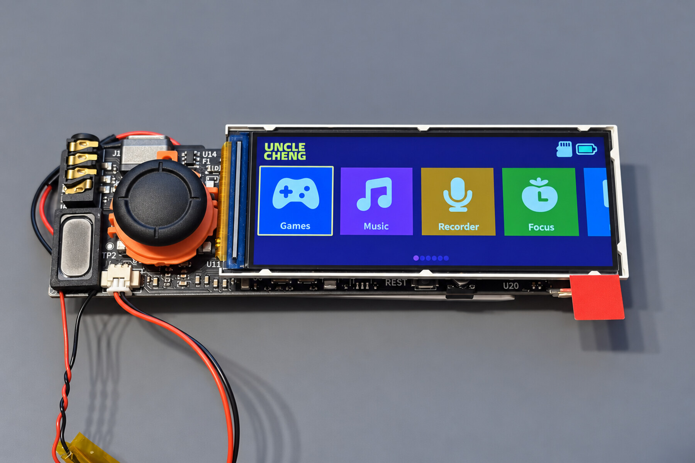

# UNCLE S3

**Describe it. Make it. Play it. Change it.**

**Let your AI read the developer kit, then start building Lua games and small
interactive apps for your real UNCLE S3.**

## Download the AI-ready developer kit

**[Download UNCLE S3 Lua developer kit 0.1.0](https://github.com/UncleCheng1985/uncle-s3/raw/refs/heads/main/downloads/uncle-s3-lua-kit-0.1.0.zip)**
([SHA256](downloads/SHA256SUMS.txt))

Extract the ZIP, open its folder in your AI coding assistant, and say:

> Read AGENTS.md first. Help me make a simple game for UNCLE S3 using only this kit's real Lua APIs. Deliver the complete checked project, package and card-reader installation steps.

Includes **all 44 actual binding contracts**, editor declarations, a minimal
template, three complete examples, Python standard-library checks/packaging and
Windows installation/iteration guides. No particular AI vendor or paid IDE required.

- [AI entry](developer-kit/AGENTS.md) · [first run on Windows](developer-kit/docs/WINDOWS.md)
- [API reference](developer-kit/docs/API.md) · [complete examples](developer-kit/README.md#complete-examples)
- [compatible firmware and board](developer-kit/COMPATIBILITY.md) · [what was actually validated](developer-kit/VALIDATION.md)

Targets **ESP32-S3 Joystick v0.2 international preview.9 / Lua API1**. Requires
compatible firmware already installed; no firmware image is bundled. Static/host
checks do not prove hardware success. New public-kit examples await device testing.

An ESP32-S3 handheld development kit for turning ideas into playable Lua games with help from AI coding tools—with a real screen, joystick and sound. Made by UncleCheng Electronics.

**Edit a compatible Lua project, copy it to the microSD card, and launch it on the device. No full firmware re-flash is needed for changes within the existing Lua API.**

You do not need to be an expert programmer to begin. Start with a working example, ask an AI coding assistant on your computer to explain or change it, and test the result on real hardware. Try a faster snake, a new obstacle in a dodging game, or your own falling-block puzzle rules. Basic setup, file editing and troubleshooting are still needed; AI-generated code may need corrections.

The device does not contain an onboard large language model. AI services run on your computer or through your chosen provider; an account or subscription is not included. Small interactive applications can use the available Lua APIs; features outside those APIs require firmware development.

This repository provides public user documentation for the **ESP32-S3 Joystick v0.2 international edition**. It does not describe the separate ESP32-P4/C3 project. The internal project name may still appear as BeatVocab in existing software and files.

## Start here

- [Quick start and app controls](QUICK_START.md)
- [Modify and install a Lua game](LUA_GAMES.md)
- [Known limitations and release status](LIMITATIONS.md)

## What can it do?

The English home screen offers six apps:

| App | Use |
| --- | --- |
| Games | Browse and run supported Lua games from a microSD card. |
| Music | Play MP3 and supported PCM16 WAV files. |
| Recorder | Save microphone recordings as WAV files and replay recent recordings. |
| Focus | Run configurable focus and break sessions. |
| Reader | Read UTF-8 English TXT files with bookmarks. |
| Settings | Adjust supported settings and view firmware information. |

Within the provided Lua API, you can change or install a game without rebuilding the entire system firmware. This does not mean compatibility with arbitrary Lua programs or commercial console games.

## Hardware

| Item | Configuration |
| --- | --- |
| MCU | ESP32-S3-WROOM-1-N16R8 |
| Memory | 16 MB Flash, 8 MB PSRAM; part is used by the system |
| Matching display | 2.86-inch IPS, 376 × 960 native pixels |
| System interface | 960 × 376 landscape; supported games can use portrait layouts |
| Input | Two-axis analog joystick with press-to-confirm |
| Buttons | POWER, volume up/down; BOOT and RESET for maintenance |
| Audio | ES8389 codec, speaker amplifier, onboard microphone and 3.5 mm headphone/headset connector |
| Storage | microSD / TF card slot |
| Power | USB-C 5 V; separate single-cell battery interface |
| Wireless hardware | Integrated Wi-Fi and BLE; no Bluetooth headphone audio claim |

## Base kit

The base sales configuration contains one PCBA, matching display, joystick, speaker and microSD card. A battery and enclosure are not included in the base kit. Refer to the actual listing for options, availability, card capacity and delivery details. A USB cable, card reader or power adapter should not be assumed to be included.

USB-C 5 V is the recommended initial power source. Battery hardware does not mean routine charging is enabled: see [power limitations](LIMITATIONS.md#power-and-battery).

## Downloads and source code

This repository provides a complete **Lua content developer kit** with source,
permitted example resources and a versioned ZIP above. It is not a full system
firmware or full customer-card distribution. No public firmware binary is supplied.
Do not erase/reflash using an unrelated ESP32 image; obtain board-specific verified
firmware and recovery instructions from the seller if your build is incompatible.

The full firmware, hardware design and artwork are not licensed as open source by the existence of this repository. Source-release scope and third-party notices will be stated separately. Individual examples can have their own licenses.

## Questions and feedback

Open a GitHub issue for documentation questions or reproducible software problems. Include your board version, firmware version from Settings → About, steps to reproduce and any error message. Do not post Wi-Fi passwords, bank information, private recordings or personal shipping details.

For an order, delivery or hardware issue, contact the seller through the marketplace where you purchased the kit. Please distinguish official firmware behavior from changes in your own scripts.

Product photographs are retouched for surface cleanliness. They show the development-board form factor; original photos and engineering records remain the reference for fine physical details. Accessories pictured for demonstration are not automatically included.
